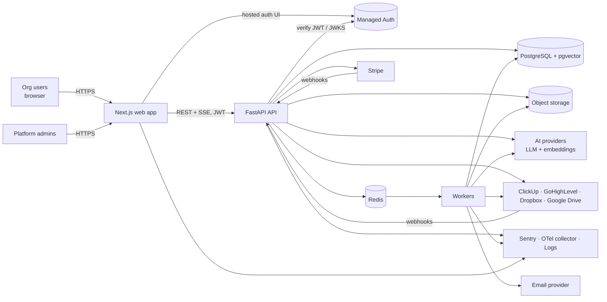
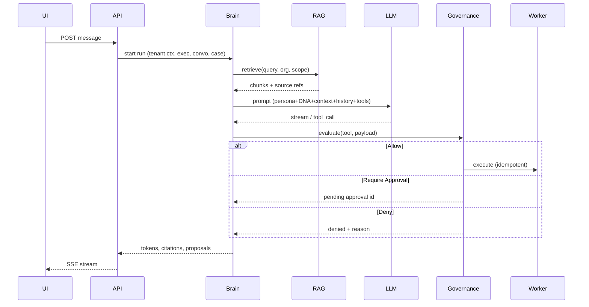

# 06 — System Architecture

| Field | Value |
|---|---|
| Status | DRAFT v0.1. All technology choices are PROPOSED (see `DECISION_LOG.md`). |
| Date | 2026-10-14 |

## 1. Existing stack evaluation
The repository has no code (see `PROJECT_BASELINE.md`), so there is no existing stack to preserve or migrate. The choices below are made on their merits. If the client has a mandated stack or an existing codebase elsewhere, that overrides this document (OQ-020).

## 2. Recommended stack (PROPOSED)

| Concern | Recommendation | Rationale | Alternatives considered |
|---|---|---|---|
| Architecture style | **Modular monolith**: one API service + one worker service sharing a codebase (DEC-001) | Small team, fast iteration, a single deploy unit, clear module boundaries that can be split later | Microservices (rejected: operational overhead) |
| Frontend | **Next.js (App Router) + React + TypeScript**, Tailwind CSS + headless primitives (Radix/shadcn), TanStack Query (DEC-002) | Mature, SSR for marketing/auth pages, strong ecosystem | Vite SPA (simpler hosting, but no SSR) |
| Backend | **FastAPI (Python 3.12+)**, Pydantic v2, SQLAlchemy 2.x + Alembic (DEC-003) | Python has the best AI/RAG/document-parsing ecosystem; async; OpenAPI generated automatically | Node/NestJS (would unify languages, but has weaker parsing/ML tooling) |
| Database | **PostgreSQL 16 + pgvector** (DEC-004) | One store for relational data and vectors; transactions across both; RLS for tenant isolation | A dedicated vector DB (Pinecone/Qdrant): defer until scale requires it |
| Tenant isolation | Shared schema, `organization_id` on every tenant table, app-level scoping **and** Postgres Row-Level Security (DEC-005) | Defense in depth with low ops cost | Schema- or DB-per-tenant (higher ops cost) |
| Authentication | **Managed auth provider** with organizations support. Candidates: Clerk, WorkOS AuthKit, Auth0 (DEC-006, final choice OQ-019) | MFA, SSO, email verification and session security out of the box | Self-built (rejected: risk) |
| Authorization | Our own RBAC + capability checks in the API (not delegated to the auth provider) | Business rules (spec 02) need to live in our domain | — |
| Background jobs | **Redis + a Python task queue** (Celery or Dramatiq) with scheduled jobs (DEC-007) | Ingestion, AI follow-through, webhooks, publishing, syncs | Postgres-backed queue (fewer components, but weaker tooling) |
| Real-time | **Server-Sent Events** for AI streaming and notifications (DEC-008) | Simple, works through proxies; one-way is sufficient | WebSockets (only needed if collaboration becomes bidirectional) |
| Object storage | **S3-compatible** (AWS S3, Cloudflare R2, etc.), org-prefixed keys, pre-signed URLs | Standard | — |
| AI providers | A provider abstraction layer. Default: Anthropic Claude models; OpenAI-compatible adapter as a secondary option; embeddings from a dedicated embeddings provider (DEC-009, OQ-013) | No lock-in; per-tenant/per-executive model tiering | — |
| Billing | **Stripe** Checkout + Customer Portal + webhooks | CONFIRMED integration | — |
| Email | Transactional provider (Postmark/Resend/SES) (OQ-029) | Invites, notifications | — |
| Observability | **Sentry** (errors, FE+BE) + **OpenTelemetry** traces + structured JSON logs (DEC-010; spec 13) | — | — |
| Hosting | Container-based. Candidates: Railway/Render/Fly (simpler) or AWS (ECS + RDS) (OQ-014) | Containers keep us portable | — |

## 3. Context diagram



## 4. Backend module boundaries (modular monolith)

```
backend/app/
  core/            config, security, db session, tenancy context, errors, logging, telemetry
  identity/        users, orgs, memberships, invitations, roles/capabilities
  billing/         plans, subscriptions, entitlements, Stripe adapter + webhooks, usage metering
  knowledge/       org DNA, documents, ingestion pipeline, chunking, embeddings, retrieval
  brain/           orchestrator, context builder, provider abstraction, tool registry, prompts, evals
  executives/      executive templates, instances, config versions, offices
  conversations/   conversations, messages, runs, streaming
  boardroom/       sessions, participants, turns, synthesis
  work/            cases, projects, tasks, decisions, proposals, activity
  governance/      policies, policy engine, approvals, action execution, audit
  integrations/    provider adapters (clickup, ghl, dropbox, gdrive), oauth, token vault, webhooks, sync
  content/         content items, versions, review, scheduling, publishing adapters
  notifications/   in-app + email
  admin/           platform admin endpoints, health, incidents, job control
  workers/         task definitions (thin; call module services)
```

**Rules**
- Modules talk to each other through service interfaces, never through another module's tables.
- Every repository method takes a `TenantContext`.
- Only `governance.execute_action()` may call integration *write* methods (enforced by an import-linter rule plus tests).

## 5. Frontend structure
```
frontend/
  app/(public)/          sign-in, sign-up, invite
  app/(app)/[org]/...    authenticated tenant routes (S-09 … S-53)
  app/(admin)/admin/...  platform admin (S-54 … S-57)
  components/ui/         design-system primitives (spec 05)
  components/features/   feature components (office, boardroom, approvals…)
  lib/api/               typed client generated from the FastAPI OpenAPI spec
  lib/auth/              auth provider integration
```

## 6. Key data flows

### 6.1 Request lifecycle
Browser → Next.js → API (`Authorization: Bearer <JWT>`, `X-Org-Id`) → middleware: verify the JWT → resolve the user → verify the membership in `X-Org-Id` → set `TenantContext` → `SET LOCAL app.org_id` for RLS → handler → response with an `X-Request-Id` header.

### 6.2 Executive run (simplified)


### 6.3 Ingestion
Upload → object storage → job: validate → parse → normalize → chunk → embed (batched) → upsert `document_chunks` (with `organization_id`, `document_id`, `collection_id`) → status `ready`.

## 7. Deployment topology (PROPOSED)
- Services: `web` (Next.js), `api` (FastAPI/uvicorn, ≥2 instances), `worker` (≥1, autoscaled on queue depth), `scheduler` (1 instance, beat), managed Postgres, managed Redis, object storage.
- Environments: local (Docker Compose), staging, production (spec 12).

## 8. Security architecture summary (details in spec 10)
TLS everywhere. JWT verification against JWKS. RBAC plus RLS. Integration tokens encrypted with envelope encryption (a KMS-managed key, or a libsodium sealed key from the secret store). Webhook signature verification. Least-privilege OAuth scopes. Rate limiting per user and per org. Prompt-injection mitigations in the Brain (spec 09 §9).

## 9. Cost considerations
| Driver | Mitigation |
|---|---|
| LLM tokens (largest variable cost) | Model tiering (a small model for routing/summaries, a large one for executive reasoning), prompt caching for stable persona+DNA prefixes, context budget limits, per-org credit caps |
| Embeddings | Embed once, using content-hash dedupe; re-embed only on model change |
| Boardrooms (N× runs) | Cap on rounds and executives per plan; a summarized shared context between turns |
| Postgres + pgvector | Start on one managed instance; HNSW indexes; partition chunks by org if needed later |
| Observability | Sample traces (e.g. 10–20% in prod, 100% on errors), log retention tiers |

Budget figures are NEEDS CLARIFICATION (OQ-013, OQ-014).
