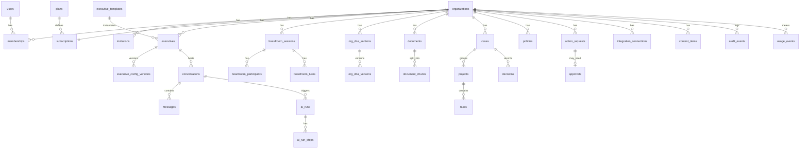

# 07 — Database and Data Model

| Field | Value |
|---|---|
| Status | DRAFT v0.1. Conceptual and logical model only. **No models or migrations have been created.** |
| Date | 2026-10-14 |
| Engine | PostgreSQL 16 + pgvector (PROPOSED, DEC-004) |

## 1. Conventions
- Primary keys: `id UUID` (v7, time-ordered), generated by the application.
- Every **tenant-owned** table has `organization_id UUID NOT NULL REFERENCES organizations(id)`. It is the first column in composite indexes. RLS is enabled with the policy `organization_id = current_setting('app.org_id')::uuid`.
- Timestamps: `created_at`, `updated_at` (timestamptz, UTC). Soft delete: `deleted_at` where noted.
- Who did it: `created_by_user_id` (nullable for system), plus `created_by_executive_id` where an AI can originate the record.
- Enums: Postgres `text` + CHECK constraints (easier to migrate than native enums).
- Money: integer minor units + currency code.
- JSON: `jsonb` only for genuinely schemaless data (provider payloads, config blobs). Keep it validated by Pydantic schemas.

## 2. Entity overview

## 3. Tables (logical)

### 3.1 Identity and tenancy
| Table | Key fields | Constraints / indexes |
|---|---|---|
| `users` | id, auth_provider_user_id, email, name, avatar_url, is_platform_admin, platform_role, last_seen_at, deleted_at | UNIQUE(auth_provider_user_id); UNIQUE(lower(email)) |
| `organizations` | id, name, slug, industry, size_band, timezone, status (active/past_due/read_only/suspended/deleted), owner_user_id, deleted_at, purge_after | UNIQUE(slug) |
| `memberships` | id, organization_id, user_id, role (owner/admin/member/viewer), capabilities text[], status (active/disabled), joined_at | UNIQUE(organization_id, user_id); partial UNIQUE(organization_id) WHERE role='owner' |
| `invitations` | id, organization_id, email, role, capabilities, token_hash, invited_by, expires_at, accepted_at, revoked_at | UNIQUE(token_hash); idx(organization_id, email) |

### 3.2 Billing and usage
| Table | Key fields | Notes |
|---|---|---|
| `plans` | id, code, name, stripe_product_id, stripe_price_ids jsonb, entitlements jsonb, is_public, sort | Platform-owned (no org_id) |
| `subscriptions` | id, organization_id, plan_id, stripe_customer_id, stripe_subscription_id, status, current_period_end, cancel_at, trial_end, grace_until | UNIQUE(organization_id); UNIQUE(stripe_subscription_id) |
| `entitlement_overrides` | id, organization_id, key, value jsonb, reason, set_by, expires_at | Platform-admin overrides |
| `usage_events` | id, organization_id, user_id, executive_id, kind (ai_tokens/embedding_tokens/storage_bytes/content_item/…), quantity, cost_micro_usd, ai_run_id, occurred_at | idx(organization_id, kind, occurred_at). Partition monthly (later) |
| `usage_counters` | organization_id, period, key, value | Fast entitlement checks; rebuilt from events |
| `webhook_events` | id, provider, event_id, type, received_at, processed_at, status, error, payload_ref | UNIQUE(provider, event_id). Idempotency |

### 3.3 Executives, conversations, AI
| Table | Key fields | Notes |
|---|---|---|
| `executive_templates` | id, key, name, role_title, default_mandate, default_persona jsonb, default_tools, accent, avatar, version, status (active/retired), sort | Platform-owned starting points. **The content of the five standard templates is OQ-003.** Retiring a template does not affect executives already created from it |
| `executives` | id, organization_id, template_id NULL (NULL = custom), template_version, display_name, role_title, status (enabled/disabled), active_config_version_id, avatar, accent, created_by, deleted_at | UNIQUE(organization_id, lower(display_name)) WHERE deleted_at IS NULL; idx(organization_id, status). **No limit in the schema**: the count is enforced by the entitlement service (`executives.max`) inside the create/enable transaction, using a per-org advisory lock |
| `executive_config_versions` | id, organization_id, executive_id, role_title, mandate text, persona jsonb (tone, focus areas, custom instructions), knowledge_scope jsonb, enabled_tools text[], model_tier, created_by, created_at, version_no | Immutable rows; restore = new version copying an old one |
| `conversations` | id, organization_id, executive_id, owner_user_id, case_id NULL, title, visibility (private/shared/org), deleted_at | idx(organization_id, owner_user_id, updated_at desc) |
| `conversation_shares` | conversation_id, organization_id, user_id | |
| `messages` | id, organization_id, conversation_id NULL, boardroom_turn_id NULL, role (user/executive/system/tool), author_user_id, executive_id, content text, content_format, citations jsonb, ai_run_id, created_at | CHECK exactly one parent; idx(conversation_id, created_at) |
| `ai_runs` | id, organization_id, kind (office/boardroom_turn/synthesis/followup/content/dna_draft/ingest_summary), executive_id, conversation_id, boardroom_session_id, provider, model, status, input_tokens, output_tokens, cached_tokens, cost_micro_usd, latency_ms, trace_id, error_code, started_at, finished_at | idx(organization_id, started_at) |
| `ai_run_steps` | id, organization_id, ai_run_id, seq, type (retrieval/llm_call/tool_call/governance), detail jsonb (redacted), duration_ms | Retention-limited |

### 3.4 Boardroom
| Table | Key fields |
|---|---|
| `boardroom_sessions` | id, organization_id, owner_user_id, topic, agenda, case_id, status (draft/active/paused/closed), rounds, summary jsonb, started_at, closed_at |
| `boardroom_participants` | id, organization_id, session_id, participant_type (executive/user), executive_id, user_id, role (owner/participant/observer) — UNIQUE(session_id, executive_id) and UNIQUE(session_id, user_id) |
| `boardroom_turns` | id, organization_id, session_id, seq, speaker_type, executive_id, user_id, status, ai_run_id — UNIQUE(session_id, seq) |

### 3.5 Knowledge
| Table | Key fields | Notes |
|---|---|---|
| `org_dna_sections` | id, organization_id, key, current_version_id, completeness | UNIQUE(organization_id, key) |
| `org_dna_versions` | id, organization_id, section_id, content jsonb, content_text, created_by, created_at, version_no | |
| `collections` | id, organization_id, name, description | |
| `knowledge_sources` | id, organization_id, integration_connection_id, provider, external_folder_id, sync_mode, last_synced_at, status | |
| `documents` | id, organization_id, collection_id, source (upload/gdrive/dropbox), external_id, name, mime_type, size_bytes, content_hash, storage_key, status (pending/processing/ready/failed/deleting), error, page_count, uploaded_by, deleted_at | UNIQUE(organization_id, content_hash) WHERE deleted_at IS NULL |
| `document_chunks` | id, organization_id, document_id, collection_id, seq, text, token_count, page_from, page_to, heading_path, embedding vector(N), embedding_model, tsv tsvector | HNSW index on embedding (vector_cosine_ops); GIN on tsv; idx(organization_id, document_id) |

*N (embedding dimensions) depends on the chosen embedding model (OQ-013).*

### 3.6 Work management
| Table | Key fields |
|---|---|
| `cases` | id, organization_id, title, description, status (open/in_progress/on_hold/closed), priority, owner_user_id, external_refs jsonb, deleted_at |
| `projects` | id, organization_id, case_id NULL, name, description, status, start_date, due_date, clickup_list_id |
| `tasks` | id, organization_id, project_id NULL, case_id NULL, title, description, status, priority, owner_type (user/executive), owner_user_id, owner_executive_id, due_at, completed_at, source_type, source_id, external_refs jsonb — CHECK owner fields consistent |
| `decisions` | id, organization_id, case_id NULL, statement, rationale, alternatives jsonb, status (proposed/accepted/rejected/superseded), decided_by_user_id, decided_at, supersedes_id, source_type, source_id |
| `decision_contributors` | decision_id, organization_id, executive_id |
| `case_memory_versions` | id, organization_id, case_id, version_no, content jsonb (facts, open_questions, constraints, stakeholders, decisions, next_steps), content_text, source_type, source_id, created_by_type (ai/user), created_at. `cases.current_memory_version_id` points to the latest. |
| `work_links` | id, organization_id, from_type (case/project/task), from_id, to_type (decision/action_request/conversation/boardroom_session/content_item), to_id, created_by. UNIQUE(from_type, from_id, to_type, to_id). Covers SOW §3, "link work to decisions and approvals" |
| `proposals` | id, organization_id, kind (task/decision/case/project), payload jsonb, proposed_by_executive_id, source_type, source_id, status (pending/confirmed/rejected), resolved_by, resolved_at, created_record_id |
| `comments` | id, organization_id, subject_type, subject_id, author_user_id, body |
| `activity_events` | id, organization_id, subject_type, subject_id, actor_type, actor_id, verb, data jsonb, created_at |

### 3.7 Governance
| Table | Key fields | Notes |
|---|---|---|
| `policies` | id, organization_id, name, priority, subject jsonb (executives, tools, action classes), conditions jsonb, effect (allow/deny/require_approval), approver_rule jsonb, allow_self_approval bool, enabled, version | idx(organization_id, enabled, priority) |
| `action_requests` | id, organization_id, tool_key, integration_connection_id, requested_by_user_id, executive_id, ai_run_id, payload jsonb, payload_hash, policy_id, evaluation (allow/deny/require_approval), status (pending_approval/approved/rejected/expired/executing/succeeded/failed/denied), idempotency_key, result jsonb, error, expires_at | UNIQUE(idempotency_key) |
| `approvals` | id, organization_id, action_request_id, decided_by_user_id, decision (approved/rejected), comment, payload_hash_at_decision, decided_at | UNIQUE(action_request_id) — only one decision. Multi-approver support is OQ-021 |
| `audit_events` | id, organization_id NULL (platform events), actor_type, actor_id, action, target_type, target_id, ip, user_agent, request_id, data jsonb (redacted), created_at, prev_hash, hash | Append-only: no UPDATE/DELETE grants for the app role; hash chain for tamper evidence |

### 3.8 Integrations
| Table | Key fields | Notes |
|---|---|---|
| `integration_connections` | id, organization_id, provider, status (connected/needs_reauth/disconnected/error), external_account_id, external_account_name, scopes text[], encrypted_credentials bytea, key_version, token_expires_at, connected_by, settings jsonb | UNIQUE(organization_id, provider, external_account_id) |
| `integration_mappings` | id, organization_id, connection_id, local_type, local_id, external_type, external_id, last_synced_at | UNIQUE(connection_id, external_type, external_id) |
| `integration_events` | id, organization_id, connection_id, direction (inbound/outbound), operation, status, http_status, duration_ms, request_id, error, created_at | Activity log (S-47) |

### 3.9 Content Factory
| Table | Key fields |
|---|---|
| `content_items` | id, organization_id, type, channel, title, brief jsonb, status (draft/in_review/approved/scheduled/published/failed/archived), executive_id, current_version_id, destination, scheduled_at, published_at, external_id, action_request_id |
| `content_versions` | id, organization_id, content_item_id, body, body_format, created_by_type, created_by_id, version_no |
| `content_assets` | id, organization_id, content_item_id NULL, kind (audio/video/document/image), source (upload/gdrive/dropbox), storage_key, mime_type, size_bytes, duration_s, status (pending/transcribing/ready/failed), error, deleted_at |
| `transcripts` | id, organization_id, content_asset_id, provider, language, text, segments jsonb (start, end, speaker, text), status, cost_micro_usd |

`content_items.status` also gains `intake`, `transcribing` and `drafting` (WF-14).

### 3.11 Retention settings
| Table | Key fields |
|---|---|
| `retention_settings` | organization_id (PK), conversations_days NULL (null = keep), documents_days NULL, content_days NULL, deleted_items_restore_days, updated_by, updated_at. The values must stay within platform bounds (OQ-016). A nightly purge job applies them, and every purge is audited |

### 3.10 Notifications and operations
| Table | Key fields |
|---|---|
| `notifications` | id, organization_id, user_id, type, title, body, link, read_at, created_at |
| `notification_preferences` | user_id, organization_id, type, channel, enabled |
| `error_records` | Sentry is the source of truth. This table holds only the error IDs linked to `ai_runs`, `action_requests` and jobs, for UI display |
| `incidents` | id (platform), title, severity, status, started_at, resolved_at, commander_user_id, summary |
| `incident_events` | id, incident_id, at, type, note, actor_user_id |
| `job_records` | id, organization_id NULL, job_type, payload_ref, status, attempts, last_error, correlation_id, started_at, finished_at |

## 4. Tenant ownership summary
- **Platform-owned (no org_id)**: `plans`, `executive_templates`, `incidents`, `incident_events`, `users` (the global identity).
- **Tenant-owned (org_id + RLS)**: everything else. `audit_events` and `job_records` allow NULL org for platform events. A separate RLS policy covers platform-admin access.

## 5. Retention and deletion (PROPOSED defaults; OQ-016)
| Data | Default retention | Deletion behaviour |
|---|---|---|
| Conversations/messages | Until deleted by the user or admin | Soft delete → purge after 30 d |
| Documents + chunks + stored file | Until deleted | Immediate removal from retrieval (status `deleting`); hard purge of chunks and file within 24 h |
| `ai_run_steps` (detailed traces) | 30 days | Purge job |
| `ai_runs` (summary) | 13 months | Aggregated after that |
| `usage_events` | 25 months | Aggregated into monthly counters |
| `audit_events` | Per plan `audit_log.retention_days` (min 365 PROPOSED) | Append-only; purged only by the retention job |
| `webhook_events` | 90 days | |
| `integration_events` | 90 days | |
| Organization deletion | Soft delete; 30-day restore window | Hard purge of all tenant rows, files and vectors; Stripe customer kept per accounting requirements |
| Backups | 30 days PITR + monthly snapshots for 12 months (PROPOSED) | Deleted data persists in backups until they expire. This must be disclosed in the privacy policy |

## 6. Index and performance notes
- Composite indexes start with `organization_id`.
- Vector search: `WHERE organization_id = $1 AND collection_id = ANY($2)` + HNSW. Validate recall at the expected per-org chunk counts. Use iterative scan / `ef_search` tuning (pgvector ≥ 0.8) so filtered queries return enough rows.
- Hybrid retrieval: `tsvector` GIN for keyword search, fused with vector results.
- Hot list endpoints use keyset pagination (`created_at, id`).
