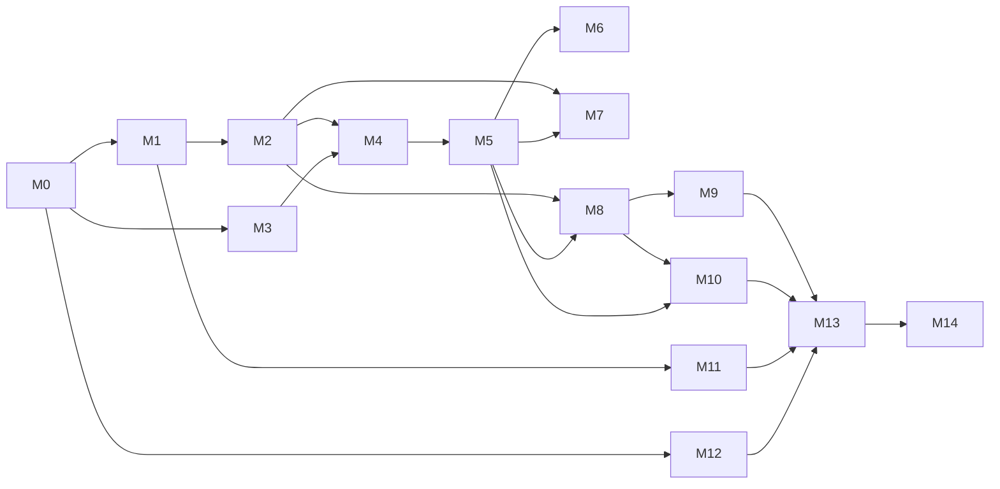

# 14 — Development Roadmap and Milestones

| Field | Value |
|---|---|
| Status | DRAFT v0.1 — PROPOSED sequence. **No delivery dates are committed.** |
| Date | 2026-10-14 |

## Estimation assumptions
- Estimates are **engineer-weeks (ew)** of hands-on development + automated tests, given as ranges. They are not calendar time and **not guarantees**.
- They assume: a greenfield repo; the stack in spec 06 is approved; a team experienced with Next.js, FastAPI and LLM apps; sandbox accounts and credentials are available when each milestone starts; designs are available ahead of the UI work for each milestone.
- **Figma design production is IN scope (SOW §2)**. It is estimated separately as milestone D1 in designer-weeks (dw) and is not included in the ew total.
- They exclude: client review/UAT waiting time, Google restricted-scope verification or GHL marketplace review, a third-party pentest, and scope changes after the SOW reconciliation.
- Uncertainty is highest for M5, M6, M9 and M10. These depend on OQ-003, OQ-007…OQ-012.
- **Indicative total: ~48–80 ew engineering + 8–14 dw design.** With a team of 3 engineers working in parallel plus a designer, that is roughly 4–7 months of build. SOW §7 requires **one fixed price**, so these ranges feed the commercial estimate but are not the quote. This is a rough, low-confidence figure to be revisited after SOW reconciliation.

## Dependency overview

M11 (billing) can run in parallel from M2 onward. Basic monitoring lands in M0; M12 completes it.

---

### Acceptance-gate rule (SOW §7, applies to every milestone)
A milestone is accepted only when (1) working software is **demonstrated in a deployed environment** (staging or production), with real AI calls and real sandbox integrations (no mockups, no simulated AI or integration actions), (2) its objective acceptance tests pass with evidence, and (3) its deliverables are **transferred** (code merged to the AdvoLevel repo, Figma files, configs/prompts, docs). Payment milestones should map to these gates. The amounts are a commercial decision and are not in this document.

### D1 — UX/UI design (Figma), runs alongside M0–M3, then continues per screen batch
- **Objectives**: an editable Figma design system and a clickable critical-flow prototype in Concept B (SOW §2).
- **Scope**: F-1…F-7 (spec 05 §9), with high-fidelity designs for all 57 reconciled screens (desktop + mobile for core flows; tablet for key layouts), in batches ahead of each build milestone.
- **Dependencies**: reconciled screen inventory (OQ-002); executive templates for avatars (OQ-003); brand assets from AdvoLevel (logo, fonts).
- **Acceptance**: client sign-off of foundations and components before M3 ends; prototype covers the agreed critical flows; editable source transferred to the AdvoLevel Figma workspace.
- **Effort**: ~8–14 designer-weeks (dw) (assumes one senior product designer and two review rounds per batch).

### M0 — Repository foundation
- **Objectives**: a reproducible dev environment and quality gates from day one.
- **Scope**: git repo, monorepo layout, Next.js + FastAPI skeletons, Docker Compose (Postgres+pgvector, Redis, MinIO), settings validation, structured logging, request IDs, Sentry wiring, OTel bootstrap, CI (lint, type, test, secret scan), pre-commit, `.env.example`, ADR template.
- **Dependencies**: DEC-001…DEC-004 approved; git hosting decided (OQ-017).
- **Deliverables**: running skeleton; `/healthz`, `/readyz`; CI green.
- **Likely files/modules**: `/frontend/*`, `/backend/app/core/*`, `/docker-compose.yml`, `/.github/workflows/*`, `/backend/alembic/*`.
- **Acceptance**: spec 11 §12 M0.
- **Tests**: smoke tests, a CI pipeline self-test, MON-01 (dev).
- **Risks**: stack not approved → rework.
- **Effort**: 1.5–2.5 ew.
- **Done when**: a new developer can clone, run and test in < 30 min following the README.

### M1 — Authentication, organizations, memberships, RBAC
- **Scope**: auth provider integration (FE + JWT verification), `users`, `organizations`, `memberships`, `invitations`, roles/capabilities, org switcher, S-01, S-02, S-05, S-06, S-49 (incl. roles tab), S-53, email sending.
- **Dependencies**: M0; auth provider chosen (OQ-019); email provider (OQ-029).
- **Likely modules**: `identity/`, `core/security`, `app/(public)`, `app/(app)/[org]/settings/*`.
- **Acceptance/Tests**: WF-01…03 AT; AZ-01 for identity endpoints.
- **Risks**: auth-provider org model vs ours (we keep our own memberships as the source of truth).
- **Effort**: 2–3 ew. **Done when**: invite → accept → role-scoped access works end to end.

### M2 — Tenant isolation hardening and audit foundation
- **Scope**: RLS policies + DB roles, `TenantContext` enforcement, schema introspection test (TI-11), cross-tenant suite harness, `audit_events` with hash chain, audit log screen S-40, rate limiting.
- **Dependencies**: M1.
- **Acceptance/Tests**: TI-01…TI-11 on all current tables; audit chain test.
- **Risks**: RLS + connection pooling pitfalls (use `SET LOCAL` inside transactions).
- **Effort**: 1.5–2.5 ew. **Done when**: every future table automatically fails CI unless it has org + RLS (or is allow-listed).

### M3 — Design system and application shell
- **Scope**: tokens (spec 05), core components, app shell/navigation, standard states (including the approval state), dashboard S-09 skeleton, notifications S-11, command palette shell S-10, Storybook, and the **public website S-W1…S-W5** (static/SSG Next.js pages; +1–2 ew).
- **Dependencies**: M0; Figma foundations F-1/F-2 (or approval to build from spec 05 directly; OQ-025).
- **Acceptance/Tests**: axe 0 serious; visual regression baseline; responsive checks.
- **Risks**: design churn without approved Figma.
- **Effort**: 3–5 ew (spread; components continue in later milestones). **Done when**: feature teams build screens only from library components.

### M4 — Organizational DNA and RAG ingestion
- **Scope**: DNA sections/versions (S-22, S-23, S-08), collections, documents, upload (S-24…S-26), ingestion pipeline (parse/chunk/embed), hybrid retrieval service, deletion pipeline, quotas.
- **Dependencies**: M2, M3; embedding provider (OQ-013); file formats (OQ-005).
- **Acceptance/Tests**: RAG-01…RAG-08; WF-04/05 AT.
- **Risks**: parsing quality on real client docs; pgvector filtered recall.
- **Effort**: 4–6 ew. **Done when**: a demo org's documents are retrievable with page-accurate sources.

### M5 — Executive Brain and Executive Offices
- **Scope**: provider abstraction, routing table, context builder, prompt caching, tool registry (internal tools), proposals, streaming SSE, cancel, usage metering, executive team management (create from a standard template or from scratch, enable/disable, soft delete, `executives.max` enforcement), standard template store (five templates; content pending OQ-003) + platform admin template management, config versions, S-12…S-17, onboarding "build your team" step, golden eval harness (per template + a generic custom-executive suite).
- **Dependencies**: M4; AI provider + budget (OQ-013); **executive definitions (OQ-003) are needed to finish, not to start**.
- **Acceptance/Tests**: AI-01…04, 06, 07; WF-06/07 AT; first-token p95 < 3 s.
- **Risks**: undefined executives; cost overrun; quality tuning time.
- **Effort**: 6–9 ew (+1 ew for customer-defined executive management). **Done when**: a customer can build a team of any size within its plan limit; all five standard templates (client-approved) and a custom executive answer with DNA + citations and propose tasks.

### M6 — Boardrooms
- **Scope**: sessions, participants, moderator planning, turn protocol, interjection, synthesis, proposals, export, S-18…S-21.
- **Dependencies**: M5; boardroom semantics (OQ-031).
- **Acceptance/Tests**: AI-05; WF-08 AT; reconnect behaviour.
- **Risks**: latency and cost of multi-turn sessions; UX of long transcripts.
- **Effort**: 3–4 ew.

### M7 — Work management (cases, projects, tasks, decisions)
- **Scope**: CRUD + activity, proposal confirmation flows, executive follow-through scheduler, S-28…S-35, dashboard widgets.
- **Dependencies**: M2, M5; case/project semantics (OQ-032).
- **Acceptance/Tests**: WF-09…11 AT.
- **Effort**: 3–5 ew.

### M8 — Governance and approvals
- **Scope**: policy model and engine, simulation, `action_requests`, approvals, `execute_action` + ExecutionToken, expiry, notifications, S-36…S-39, default policies, platform floor rules.
- **Dependencies**: M2, M5; approval model details (OQ-021).
- **Acceptance/Tests**: AB-01…AB-12 at 100%; policy property tests.
- **Risks**: complexity creep in the condition language. Keep V1 conditions to a fixed set.
- **Effort**: 3–4 ew. **Done when**: no integration write can execute except through approved/allowed requests (proven by tests).

### M9 — Integrations (Google Drive, Dropbox, ClickUp, GoHighLevel)
- **Scope**: OAuth framework, token vault, refresh, webhooks framework, per-provider adapters for the **confirmed** operations, knowledge-source sync (Drive/Dropbox → M4 pipeline), ClickUp task sync, GHL CRM tools, S-27, S-45…S-47.
- **Dependencies**: M8; OQ-007…OQ-010; developer apps and sandbox accounts (OQ-017); Google scope decision (DEC-013).
- **Acceptance/Tests**: spec 11 §7 per provider; E2E-06.
- **Risks**: provider approvals (Google verification, GHL marketplace), API changes, rate limits.
- **Effort**: 6–10 ew (≈1.5–2.5 per provider).

### M10 — Content Factory
- **Scope**: media/document intake (upload + Drive/Dropbox import), **transcription via a third-party STT API**, AI drafting and transformation with brand voice, text editor (no media editor), versions, review/approval, status tracking, scheduling, **at least one agreed publish/export destination working end to end**, S-41…S-44.
- **Dependencies**: M5, M8, (M9 for export destinations); **publishing destinations (OQ-012)**; content types (OQ-022).
- **Acceptance/Tests**: WF-14 AT; AB suite applied to publishing.
- **Effort**: 4–6 ew including transcription (+ 1–2 ew for each destination beyond the first).

### M11 — Billing and entitlements
- **Scope**: plans, Stripe customer/Checkout/Portal, webhook processing, subscription state machine, entitlement service (used across all modules), usage counters, grace/read-only mode, S-07, S-51, S-52, S-56.
- **Dependencies**: M1; plans and prices (OQ-011). The entitlement *framework* should land early (stub plan) so other milestones call it.
- **Acceptance/Tests**: BL-01…BL-08.
- **Effort**: 2–4 ew.

### M12 — Monitoring completion, backup/recovery, platform admin
- **Scope**: dashboards, alerts, cost monitoring, incident records, job control, S-54, S-55, S-57, backup configuration, runbooks, restore drill.
- **Dependencies**: M0; hosting chosen (OQ-014); support model (OQ-018).
- **Acceptance/Tests**: MON-01…MON-10.
- **Effort**: 3–4 ew.

### M13 — Hardening, performance and security review
- **Scope**: load tests, query tuning, security scans, fixing findings, accessibility pass, E2E completion, (optional) third-party pentest support.
- **Acceptance/Tests**: spec 11 §12 M13; SD-01…SD-05.
- **Effort**: 3–5 ew.

### M14 — Production deployment, UAT and handover
- **Scope**: production environment, DNS/TLS, release process dry run, UAT support, documentation to as-built, handover pack and session.
- **Dependencies**: all prior; client UAT availability.
- **Acceptance**: E2E-01…E2E-10 on staging; UAT sign-off; handover checklist (spec 12 §10).
- **Effort**: 2–4 ew (excluding client UAT duration).

## Effort summary
| Milestone | Range (ew) | Confidence |
|---|---|---|
| M0 | 1.5–2.5 | Medium |
| M1 | 2–3 | Medium |
| M2 | 1.5–2.5 | Medium |
| M3 | 4–7 | Low (design dependent; includes the public website) |
| M4 | 4–6 | Medium |
| M5 | 6–9 | Low |
| M6 | 3–4 | Low |
| M7 | 3–5 | Medium |
| M8 | 3–4 | Medium |
| M9 | 6–10 | Low |
| M10 | 4–6 | Low |
| M11 | 2–4 | Medium |
| M12 | 3–4 | Medium |
| M13 | 3–5 | Medium |
| M14 | 2–4 | Medium |
| **Total (engineering)** | **~48–80** | Low overall until the master SOW and inclusion matrix are reconciled |
| D1 Design | 8–14 dw | Separate (designer-weeks) |
